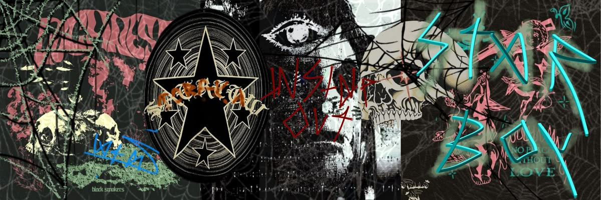

# ANKOM STUDIOS

### Independent Creative & Digital Development

Building, maintaining, and distributing software, games, digital libraries, and creative projects.

---

## About Us

Ankom Studios is an independent development studio focused on creating digital experiences, experimental software, games, and community-driven projects.

We believe in open development, continuous improvement, and making useful digital resources accessible to everyone.

## Projects & Development

Our development spans multiple independent projects and platforms, including:

| Project | Focus |
|---|---|
| **Arch Piskel** | Creative tools and pixel-art development |
| **Wannasmile** | Unblocked games and digital resources |
| **Riptide** | Web-based entertainment and gaming |
| **Studio Infrastructure** | Websites, accounts, hosting, and shared services |

## Development & Contributions

- Continuous development and maintenance of existing projects.
- New features, improvements, and experimental releases.
- Open-source repositories and community contributions.
- Bug fixes, performance improvements, and infrastructure updates.
- Collaboration across different creative and technical projects.

## GitHub Activity

Explore our [repositories](https://github.com/orgs/ankom-studios/repositories), [commits](https://github.com/ankom-studios/.github/commits/main), and [organization activity](https://github.com/orgs/ankom-studios/activity).

## Get Involved

Have an idea, found a bug, or want to contribute?

- **Explore:** Browse our public repositories.
- **Contribute:** Submit issues, improvements, and pull requests.
- **Collaborate:** Get involved with our community and projects.
- **Contact:** ankomstudios@gmail.com

---

**ANKOM STUDIOS © 2026**

*Independent development. Endless possibilities.*

[Website](https://ankomstudios.com) · [GitHub](https://github.com/ankom-studios)

